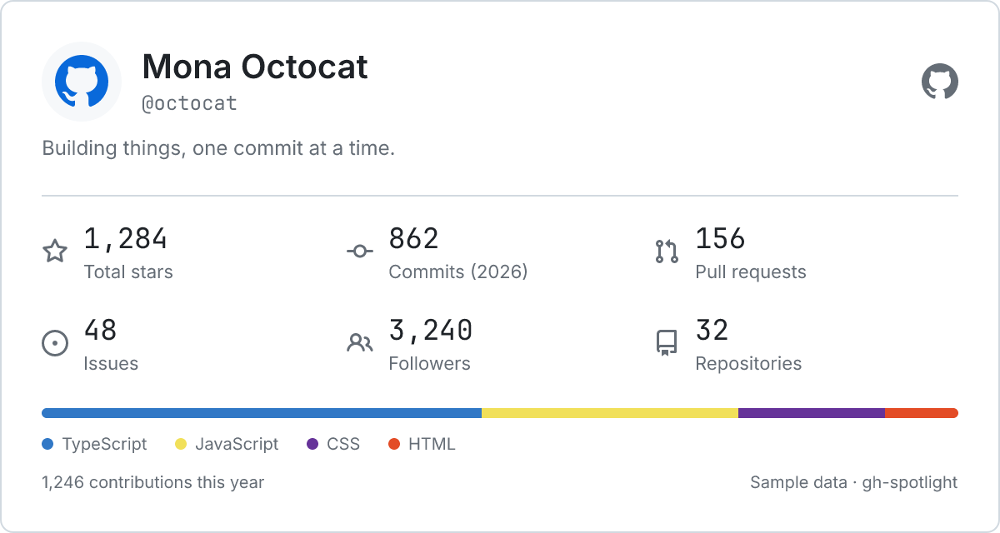
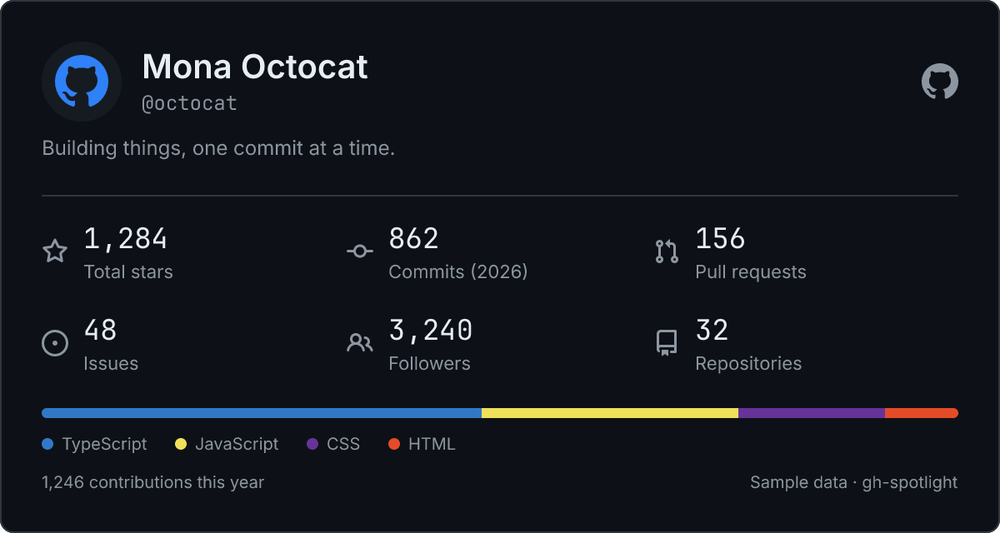
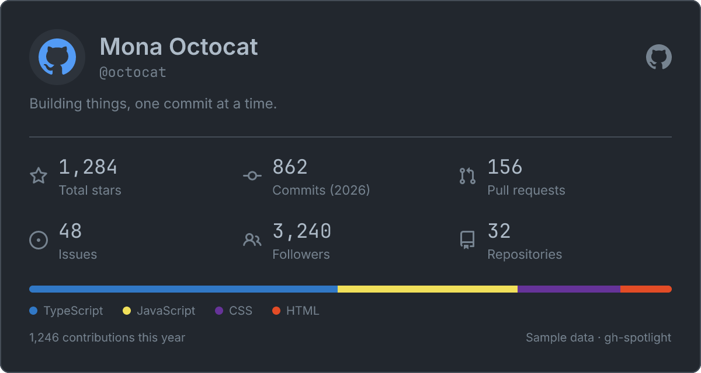
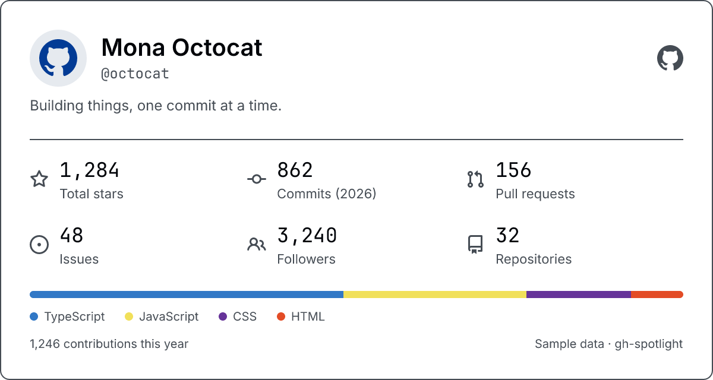
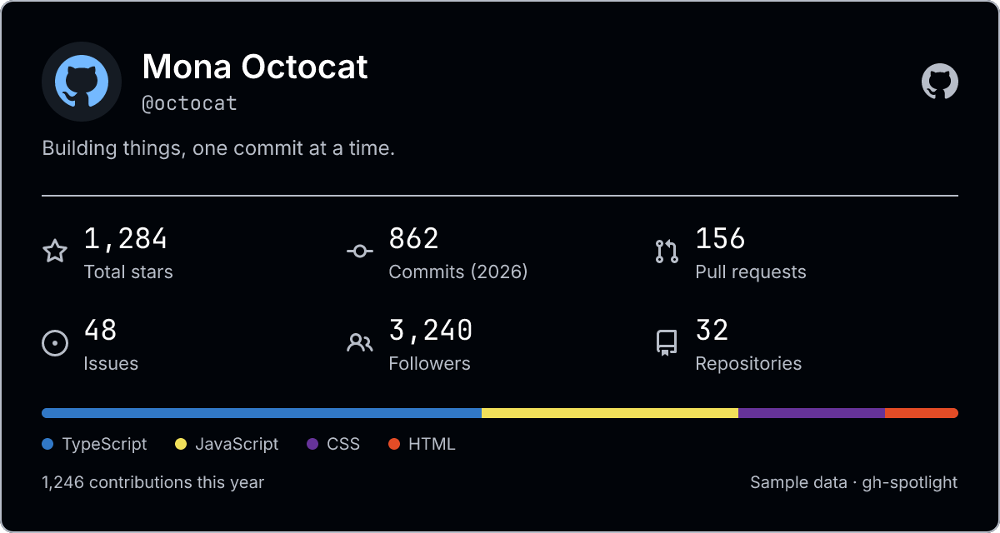

# gh-spotlight

Generate GitHub profile and statistics cards as crisp, 1200 × 640 PNGs. Built with Next.js App Router, strict TypeScript, Primer colors and Octicons, Satori, and resvg. No browser is used for image generation.

## Run locally

Use Node.js 22 LTS or newer and npm.

```sh
npm ci
cp .env.example .env.local
# Set GITHUB_TOKEN in .env.local
npm run dev
```

Open http://localhost:3000. The initial playground uses **explicit sample data** so it works before configuring GitHub. Submit a username to request live data. Shareable embed snippets always point to live data; downloading the demo produces a labeled sample card.

Create a personal access token at https://github.com/settings/tokens. A classic token with no additional scopes can read public profiles. For fine-grained tokens, grant access appropriate to the public repositories you want to read. Keep the token on the server; never prefix it with NEXT_PUBLIC_. Use a dedicated token and rotate it as needed.

```sh
npm test
npm run typecheck
npm run build
npm start
```

## Image API

```text
GET /api/card?user=octocat&theme=dark
```

| Parameter | Default  | Accepted values                                                             |
| --------- | -------- | --------------------------------------------------------------------------- |
| `user`    | Required | GitHub handle, 1–39 letters, digits, or internal hyphens                    |
| `theme`   | `light`  | `light`, `dark`, `dark_dimmed`, `light_high_contrast`, `dark_high_contrast` |
| `hide`    | Empty    | Comma-separated `bio`, `languages`                                          |
| `border`  | `true`   | `true`, `false`                                                             |
| `radius`  | `8`      | Integer 0–32, in logical pixels                                             |
| `demo`    | `false`  | `true` renders labeled fixed sample data without GitHub access              |

Unknown parameters and invalid values return JSON with status 400. Success returns `image/png` at 1200 × 640 (600 × 320 logical pixels), with:

```text
Cache-Control: public, max-age=1800, s-maxage=3600, stale-while-revalidate=86400
```

Missing users return a Primer error PNG with HTTP 200 and `X-Card-Error: 404`, allowing README image proxies to display the message. Rate limits return a PNG with HTTP 429 and `Retry-After: 60`. Missing server configuration returns 503; upstream failures return 502. Error responses use `no-store`. PNG rendering failures return JSON with 500.

Embed on your own deployment (replace the domain):

```md

```

```html

```

## Theme previews

Bundled previews use labeled sample data. Regenerate them with `npm run previews`.

| Light                                      | Dark                                                            |
| ------------------------------------------ | --------------------------------------------------------------- |
|         |                                |
| Dark dimmed                                | Light high contrast                                             |
|  |  |



The first three token maps match the project brief. High-contrast tokens are sourced from `@primer/primitives@11.10.0` functional themes. See [Primer primitives](https://primer.style/product/primitives/). This is an independent project, not a GitHub product.

## Data semantics

The GraphQL request includes the profile, status, followers, lifetime PR/issue counts, current UTC-calendar-year commits and contributions, and public non-fork owned repositories. Stars sum those repositories. Languages aggregate byte counts for the ten largest languages in each repository, then show the five largest aggregate languages; they are not a measure of developer proficiency.

Profiles with up to 100 repositories use one GraphQL request. Larger profiles paginate because GitHub limits connection page sizes to 100; silently truncating would produce incorrect stars. A 10,000-repository safety limit returns an error instead of partial totals. The avatar is downloaded separately from GitHub's avatar host and embedded as a data URI. Avatar download failure falls back to an Octicon.

Fonts are bundled in `public/fonts`, with their licenses. Runtime card generation never fetches remote fonts. Satori uses flexbox and inline SVG paths; resvg rasterizes SVG at 2×. The native renderer is listed in `serverExternalPackages`, and fonts are included in Next.js output tracing. Deploy using the **Node.js runtime**, not Edge or a static export. Set `GITHUB_TOKEN` in your deployment's secrets configuration.

The API's cache headers assume a cache-aware hosting platform/CDN; plain `next start` does not provide a shared CDN cache. Put a cache and request-rate controls in front of a publicly exposed deployment to protect your GitHub quota. Private contributions and repositories are intentionally excluded from repository totals. The application never prints the token or returns GitHub's raw error payloads.

## Structure

- `src/lib/github.ts` — typed GraphQL client, repository aggregation, avatar embedding
- `src/lib/primer-themes.ts` — typed color maps and resolver
- `src/lib/params.ts` — strict Zod query schema
- `src/components/card/HighlightCard.tsx` — pure Satori JSX and error card
- `src/app/api/card/route.tsx` — Node image pipeline and HTTP caching
- `src/components/Playground.tsx` — URL-synced controls and exports
- `tests/core.test.ts` — validation, pagination, avatar, and upstream error tests

Run `npm run smoke` against a running production server to check all themes, PNG dimensions, cache headers, and validation. Set `TEST_ORIGIN` to target another origin. `npm run previews` regenerates README sample images.

The `fflate` override selects a patched version for Satori's transitive compression dependency.
